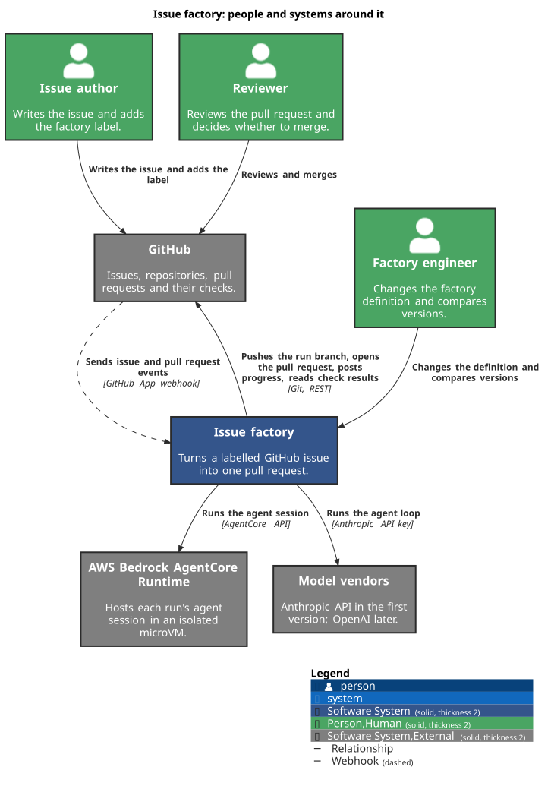

# 3. Context and scope

[workspace.dsl](./workspace.dsl) is the source of the diagram. `scripts/render-c4.sh` renders it.

## People

| Person | Responsibility |
| --- | --- |
| Issue author | Writes the issue and adds the label `factory:ready`. |
| Reviewer | Reviews the pull request and decides whether to merge it. |
| Factory engineer | Changes the factory definition and compares factory versions using the run record. |

## External systems

| System | Responsibility | Interface with the factory |
| --- | --- | --- |
| GitHub | Holds issues, repositories, pull requests and their checks. The checks decide whether the work is good. | GitHub sends issue and pull request events by GitHub App webhook. The factory uses Git and the REST API. |
| AWS Bedrock AgentCore Runtime | Hosts each run's agent session in an isolated microVM. | The run invokes the endpoint through the AgentCore API. |
| Model vendors | Run the model for the agent session. The first version uses the Anthropic API. | The sandbox calls the Anthropic API with an API key. |
