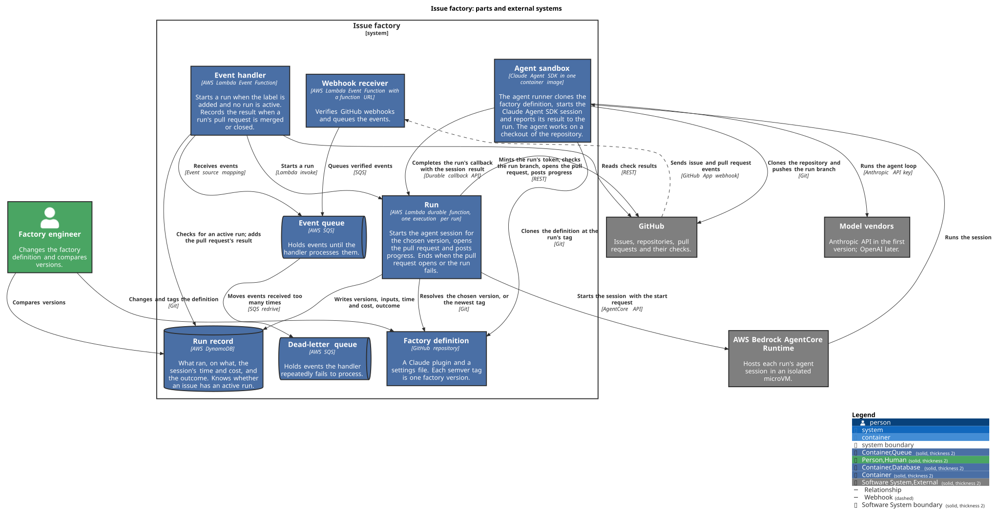

# 5. Building block view

## Level 1: containers



| Container | Technology | Responsibility |
| --- | --- | --- |
| Webhook receiver | AWS Lambda function with a function URL | Verifies the signature of each GitHub webhook and puts the event on the event queue. |
| Event queue | AWS SQS | Holds events until the event handler processes them. |
| Dead-letter queue | AWS SQS | Holds events that the event handler has failed to process too many times. |
| Event handler | AWS Lambda function | Starts a run when an issue author adds `factory:ready` and the issue has no active run. Adds the pull request's result to the run record when GitHub reports the pull request merged or closed. |
| Run | AWS Lambda durable function, one execution per run | Resolves the factory version, starts the agent session, opens the pull request, posts progress on the issue and writes the run record. |
| Agent sandbox | One container image on AgentCore Runtime, deployed together with the run | Runs the agent runner and the agent. |
| Run record | AWS DynamoDB | Stores one record per run and one claim per issue. |
| Factory definition | GitHub repository | Holds a Claude plugin and a settings file. The plugin holds the skills and the hooks. The settings file holds the model and the limits. Each semver tag is one factory version. |

## Level 2: agent sandbox

| Part | Responsibility |
| --- | --- |
| Agent runner | The factory's program in the sandbox image. Clones the factory definition at the run's tag. Starts the agent session with the plugin and the settings. Sends heartbeats while the agent works. Completes the run's callback with the result. The agent runner is fixed code. |
| Agent | The Claude Agent SDK session, set up by the factory definition. Works on a checkout of the repository and pushes the run branch. |

## Run record

The run record stores these fields for each run:

| Group | Fields |
| --- | --- |
| Factory version | The factory version's tag and commit, the harness and its version, the models, and the sandbox image. |
| Input | The issue as the run passed it to the agent, and the repository's base commit. |
| Agent session | The duration, the number of turns, the cost estimate, the token counts per model and the session ID. |
| Outcome | The run's outcome and whether the run opened a pull request. |
| After the pull request | The result of the pull request's checks, merged or closed, and the time to merge. |

The run record also stores one claim per issue. [Runtime view](./06-runtime-view.md#the-claim) describes the claim.

## Interfaces

### Labels: issue author and factory

| Label | Set by | Meaning |
| --- | --- | --- |
| `factory:ready` | Issue author | Start a run. |
| `factory:running` | Run | A run is active. |
| `factory:done` | Run | The run opened a pull request. GitHub shows the linked pull request. |
| `factory:declined` | Run | The agent chose to make no change. A comment on the issue gives the reason. |
| `factory:failed` | Run | The run failed. A comment on the issue gives the reason. |
| `factory:v<semver>`, such as `factory:v1.4.0` | Issue author | Selects the factory version. The label matches a tag in the factory definition repository exactly. The factory never removes this label. |

### Contract: run and agent runner

```text
Run ──(1) start request──▶ Agent runner ──starts──▶ Agent session
Run ◀──(3) callback─────── Agent runner ◀──result message, with (2) the agent's structured output
```

The run and the agent runner deploy together, so the messages carry no version field ([ADR 0012](../adr/0012-a-factory-version-is-a-plugin-at-a-git-tag.md)).

#### 1. Start request: run to agent runner

| Field | Purpose |
| --- | --- |
| `runId`, `callbackId` | Identify the run and the callback that the agent runner completes. |
| `factoryVersion` | Names the tag of the factory definition that the agent runner clones. |
| `repository`, `baseCommit`, `branch` | Name the repository to clone, the commit to start from, and the run branch to push. |
| `githubToken` | Lets the agent clone the repository and push the run branch. |
| `issue`: number, title, body | Gives the agent the issue. The run record stores the same values. |

#### 2. Agent's structured output

The agent ends its session with this object. The Claude Agent SDK validates the object against a JSON schema and retries on a mismatch ([structured outputs](https://code.claude.com/docs/en/agent-sdk/structured-outputs)).

| Field | Values |
| --- | --- |
| `outcome` | `completed`: the agent made the change and pushed the run branch. `declined`: the agent chose to make no change. |
| `summary` | Markdown. The run uses it as the pull request description, or as the comment that gives the reason for declining. |

An agent declines when, for example, the issue is unclear, out of scope or unsafe to do.

#### 3. Callback: agent runner to run

| Field | Source |
| --- | --- |
| `harness` name and version, `model` | The agent runner reads them from the sandbox image. |
| `subtype` | The SDK's result message: `success` or one of the `error_*` endings. |
| `durationMs`, `numTurns`, `costUsdEstimate`, `usage` per model | The SDK's result message. |
| `agent` | The agent's structured output. Present only when `subtype` is `success`. |
| `sessionId` | The SDK. A factory engineer uses it to investigate a run. |

The SDK's `error_*` endings are `error_max_turns`, `error_max_budget_usd`, `error_during_execution` and `error_max_structured_output_retries` ([agent loop](https://code.claude.com/docs/en/agent-sdk/agent-loop)). Each one means the agent session stopped before its end.

When the agent runner cannot start the agent session, it fails the callback with a reason. One cause is a plugin that the SDK did not load.
