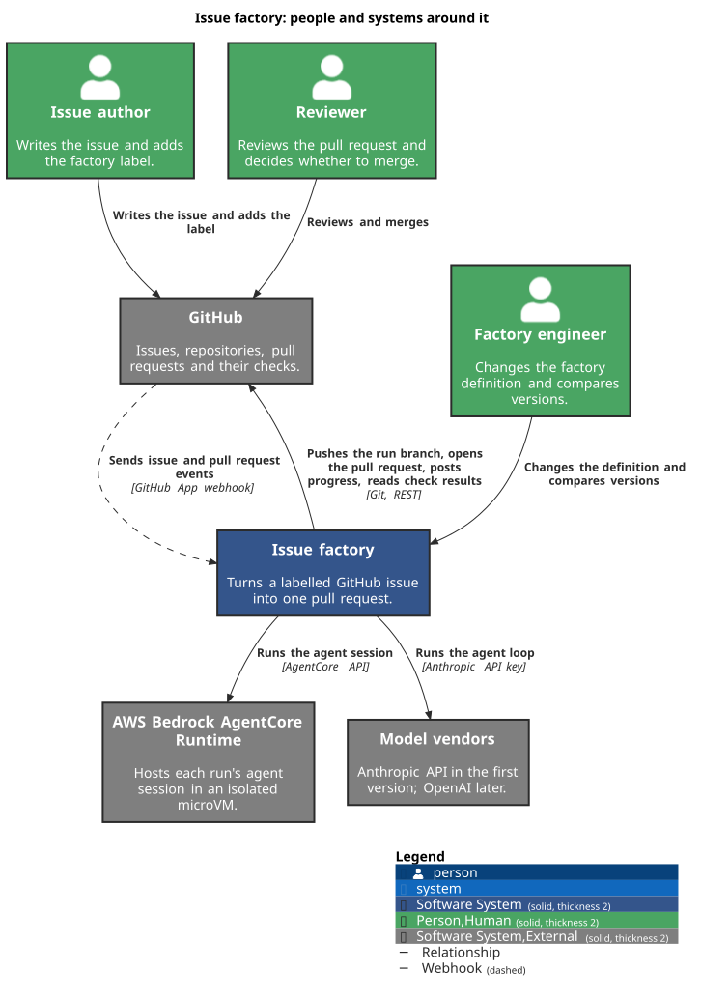
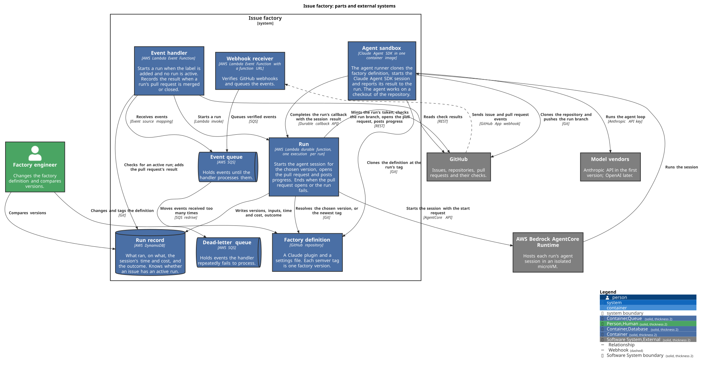

# Issue factory architecture

The factory turns a labelled GitHub issue into one pull request for a person to review. [The design notes](../software-factory.md) hold the workflow, principles and open items.

This page names the parts and what each is responsible for. It does not describe every flow. [workspace.dsl](./workspace.dsl) is the source; render the diagrams with `scripts/render-c4.sh`.

## Context

| Person or system | Responsibility |
| --- | --- |
| Issue author | Writes the issue and adds the factory label. |
| Reviewer | Reviews the pull request and decides whether to merge. |
| Factory engineer | Changes the factory definition and compares versions using the run record. |
| GitHub | Issues, repositories, pull requests and their checks. The checks decide whether the work is good. |
| AWS Bedrock AgentCore Runtime | Hosts each run's agent session in an isolated microVM. Each factory version is a runtime version behind its own endpoint. |
| Model vendors | Anthropic in the first version; OpenAI later. |

## Containers

| Container | Responsibility |
| --- | --- |
| Webhook receiver | Verifies GitHub webhooks and queues the events. Does nothing else, so it replies to GitHub quickly. |
| Event queue | Holds events until the handler processes them. |
| Dead-letter queue | Holds events the handler repeatedly fails to process. |
| Event handler | Starts a run when the label is added and the issue has no active run. Adds the result to the run record when a run's pull request is merged or closed. |
| Run | One durable execution per run. Resolves the definition version, starts the agent session at that version's endpoint, opens the pull request and posts progress on the issue. Ends when the pull request opens or the run fails. |
| Agent sandbox | The run's single agent: the Claude Agent SDK and the definition's files in one image per factory version, working on a checkout of the repository. Pushes the run branch with a scoped token ([ADR 0001](../adr/0001-agent-holds-scoped-github-token.md)). |
| Run record | What ran, on what, the session's time and cost, and the outcome. Knows whether an issue has an active run. |
| Factory definition | Instructions, skills, hooks, harness and model, in its own GitHub repository. Each semver tag builds that version's sandbox image. |

## Decided at this level

- **One active run per issue, and runs are isolated.** Adding `factory:ready` again after a run ends starts a new, independent run on the same issue. See [Starting a run](./starting-a-run.md).
- **A run ends when its pull request opens.** Nothing waits for review. When the pull request is merged or closed, the event handler adds the result to that run's record.
- **Events go through a queue.** The receiver only verifies and queues; the handler does the work, with retries and a dead-letter queue.
- **One agent per run, Claude only to start.** A run is one Claude Agent SDK session. Each version names its harness and model, so Codex can be added later.
- **Each factory version is its own image.** A semver tag builds an image with the harness and the definition's files, deployed as an immutable AgentCore Runtime version behind its own endpoint.
- **The receiver is a Lambda function URL.** GitHub can't sign requests with AWS credentials, so the URL is public and the receiver checks GitHub's webhook signature.
- **The run record is DynamoDB.** A conditional write holds an issue's active-run claim. Comparing versions starts as a script over all runs; DynamoDB's export to S3 and Athena is there when that is no longer enough. The durable function's execution history is not the record.

## Not in the first version

- **Recovering lost webhooks.** GitHub does not redeliver failed deliveries on its own. If a `factory:ready` delivery fails, nothing happens on the issue, and the author removes and re-adds the label. A scheduled job that redelivers failed deliveries can be added later without changing the design, because a redelivery keeps its delivery ID.

## Open at this level

| Open item | Notes |
| --- | --- |
| Whether the target repository's own `CLAUDE.md` loads | Useful repository knowledge, but it varies outside the factory version. The run record keeps the repository commit. |
| AgentCore endpoint names and quotas | Not found in the docs: the naming rules for endpoints, and how many versions or endpoints a runtime can have. |

## Detail

| Document | Covers |
| --- | --- |
| [Starting a run](./starting-a-run.md) | Labels, the per-issue claim, and running an issue again. |
